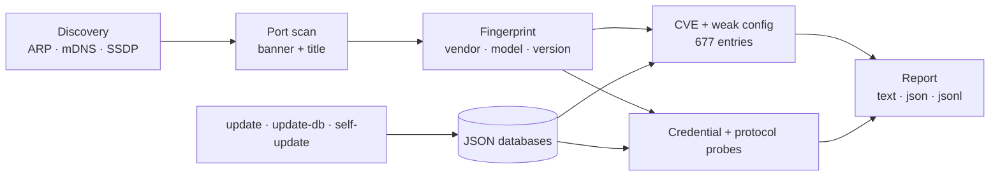

# boggy

```
 _     ___  ____  __  __
| |   / _ \|  _ \|  \/  |
| |  | | | | |_) | |\/| |
| |__| |_| |  _ <| |  | |
|____|\___/|_| \_\_|  |_|
```

[](https://github.com/rustifork/boggy/actions/workflows/ci.yml)
[](https://github.com/rustifork/boggy/releases)

**Agentless IoT network scanner. One small binary, zero Rust dependencies, no root.**

> Boggy is neither affiliated with, nor used by, nor made by the Iranian APT group Boggy Serpens.

---

## At a glance

| | |
|---|---|
| Binary size | ~1.3 MB, `std`-only, offline build |
| Databases | 677 IoT/OT CVEs, 278 credential pairs |
| Discovery | ARP, mDNS, SSDP/UPnP, TCP liveness |
| Probes | HTTP Basic/Digest/forms, Telnet, FTP, MQTT, CoAP, SNMP, Redis, Modbus, Docker, ADB… |
| Reports | text, JSON, JSONL, severity summary, CI exit codes |
| Updates | `update` = source code (git), `update-db` = data, `self-update` = binary |
| Tests | 46 unit + 11 end-to-end |

**Contents:** [Quick start](#quick-start) · [Commands](#commands) · [Security](#security) · [Architecture](#architecture) · [Testing](#testing) · [Troubleshooting](#troubleshooting)

---

## Quick start

```sh
cargo build --release              # no crates are downloaded
./target/release/boggy --auto      # scan the local /24
```

Prefer JSON for CI:

```sh
./target/release/boggy \
  --target 192.168.1.0/24 \
  --deep --output json --out report.json \
  --min-severity high --fail-on critical
```

A prebuilt x86_64 binary is attached to every [release](https://github.com/rustifork/boggy/releases). Once installed, `boggy self-update` verifies and replaces it.

---

## Commands

Three update paths, deliberately separate:

| Command | Updates | Source |
|---|---|---|
| `boggy update` | source code | `https://github.com/rustifork/boggy.git` via git |
| `boggy update-db` | CVE + credential databases | `db/manifest.json` pinned HTTPS downloads |
| `boggy self-update` | running binary | verified GitHub release asset |

### Scan

```sh
boggy --auto
boggy --target 192.168.1.0/24 --exclude 192.168.1.50/32
boggy --target 192.168.1.0/24 --fast          # 17 top IoT ports
boggy --target 192.168.1.0/24 --deep          # ~170 ports, every probe
boggy --target 192.168.1.0/24 --ports 22,80,443,8000-8100
boggy --target 192.168.1.0/24 --passive       # discovery only
boggy --target 192.168.1.0/24 -j 8 --rate-limit 32 --timeout 500
```

| Option | Meaning |
|---|---|
| `-t, --target <CIDR>` | Target network, repeatable |
| `--auto` | Detect the local /24 |
| `--exclude <CIDR>` | Skip a network, repeatable |
| `--fast` / `--deep` / `--ports <SPEC>` | Port selection |
| `--passive` | No active probes |
| `--no-creds` / `--no-cve` | Disable a probe family |
| `-j, --threads <N>` | Workers (64) |
| `--rate-limit <N>` | Max simultaneous sockets, 0 = auto |
| `--timeout <MS>` | Per-probe timeout, default 800 |
| `--cred-limit <N>` | Credential attempts per service, default 24 |
| `--max-cve <N>` | CVE findings per host, default 15 |
| `--max-hosts <N>` | Refuse larger CIDR expansions, default 65536 |
| `--min-severity <S>` | `info\|low\|medium\|high\|critical` |
| `--fail-on <S>` | Exit 2 when a finding reaches this severity |
| `-o, --output <FMT>` | `text`, `json`, `jsonl` |
| `--out <FILE>` | Write the report to a file |
| `--cve-file` / `--creds-file` | Override databases |
| `-v` | Progress on stderr |

Exit codes: `0` clean · `1` usage/scan/update error · `2` `--fail-on` threshold reached.

### Update the source code

`boggy update` uses git directly (no shell). In an existing checkout it fetches the tracked branch and fast-forwards via `reset --hard`; a dirty tree is refused unless `--force`. Outside a checkout it clones into `~/.boggy/src/boggy` or `--dir`.

```sh
boggy update                                   # fetch + apply
boggy update --dry-run                         # show the target commit only
boggy update --build                           # build after updating
boggy update --build --install                 # build and install to ~/.local/bin/boggy
boggy update --dir ~/src/boggy --branch main
boggy update --self                            # alias: verified binary self-update
boggy update --check-only                      # alias: release version check
```

| Option | Meaning |
|---|---|
| `--dir <PATH>` | Working directory; defaults to the current repo or `~/.boggy/src/boggy` |
| `--repo <URL>` | HTTPS GitHub repository |
| `--branch <NAME>` | Branch to track, default `main` |
| `--force` | Allow discarding local changes or overwriting a directory |
| `--build` / `--install` | Compile / install the release binary |
| `--install-path <P>` | Override the install destination |
| `--allow-local` | Permit `file://` repositories for offline mirrors |
| `--dry-run` | Print the commit and exit without touching files |

### Update data and binary

```sh
boggy update-db                       # both databases, SHA-256 verified
boggy update-db --cves-only
boggy update-db --creds-only
boggy update-db --dry-run             # validate and print, write nothing
boggy update-check                    # release version only
boggy db-info                         # embedded hashes and active overrides
boggy self-update                     # verified release binary
boggy selftest                        # 15 integrity/parser checks
```

---

## Security

- HTTPS by default; plain HTTP requires `--allow-http`. `curl` (or wget) validates certificates, TLS ≥ 1.2. No TLS library is linked into the binary.
- Redirects are disabled for database downloads; release assets may redirect only to GitHub-controlled hosts.
- SHA-256 digests from `db/manifest.json` (or the release `digest` / `SHA256SUMS`) are compared in constant time before any file is written.
- Files are replaced atomically: create-new temp file, `fsync`, rename. Databases are 0600, binaries 0755, symlinks never followed.
- The in-tree JSON parser enforces depth, node, string and UTF-8 limits. A malformed database never panics.
- HTTP request lines and headers are CRLF-sanitized; chunked responses are decoded.
- Replaced binaries are checked for the host architecture; source and report files use atomic writes.
- Local database overrides are structurally validated before use; CLI rejects invalid severity, format and conflicting flags.
- Git arguments are passed as an array, branch names and URLs are validated, and local changes cannot be silently discarded.

Performance notes: one connection per port, connect timeout capped at 400 ms,
mDNS/SSDP run concurrently, both JSON databases are parsed once per scan, and UDP/SNMP
or credential retries are time-bounded so a single quiet host cannot stall a worker.

**Out of scope:** TLS inspection, active exploitation, authenticated version confirmation, zero-day discovery. A CVE match means "this device looks affected" — confirm with the vendor advisory.

Only scan networks you own or are authorized to test.

---

## Architecture



Everything lives in `src/`: `net` (discovery, ports, HTTP, MD5, SHA-256), `iot` (fingerprints, credentials, protocols, CVEs, UPnP), `json` (bounded parser/writer), `update` (verified downloads), `source` (git updates), `selftest`. See [docs/architecture.md](docs/architecture.md).

---

## Testing

```sh
cargo test                 # 46 unit + 11 end-to-end checks
cargo run -- selftest      # runs inside the binary, no cargo needed on target
cargo fmt --check
```

The end-to-end suite drives the built binary: help/version, `db-info`, `selftest`, dry-run, bad-checksum abort, report shapes, invalid inputs, and a complete offline `boggy update` cycle against a temporary git repository (clone, fetch, dirty-tree guard, `--force`).

CI checks zero dependencies, formatting, clippy, database hashes, all tests, the in-binary selftest, and a <5 MB release binary on x86_64, aarch64 and armv7.

---

## Troubleshooting

| Symptom | Fix |
|---|---|
| `plain HTTP refused` | Use HTTPS or pass `--allow-http` |
| `checksum mismatch` | Re-run `update-db`; the mirror or download is stale |
| `curl and wget are unavailable` | Install `curl` for HTTPS updates |
| `working tree has local changes` | Commit them or pass `--force` |
| `target expands to N hosts` | Narrow `--target` or raise `--max-hosts` |
| No CVE findings | Try `--deep`; banners must expose a vendor; lower `--min-severity` |
| `--fast and --deep are mutually exclusive` | Pick one port profile |

---

## Project

[Usage details](docs/usage.md) · [Architecture](docs/architecture.md) · [Contributing](CONTRIBUTING.md) · [Changelog](CHANGELOG.md)

Dual-licensed under [MIT](LICENSE-MIT) or [Apache-2.0](LICENSE-APACHE).
